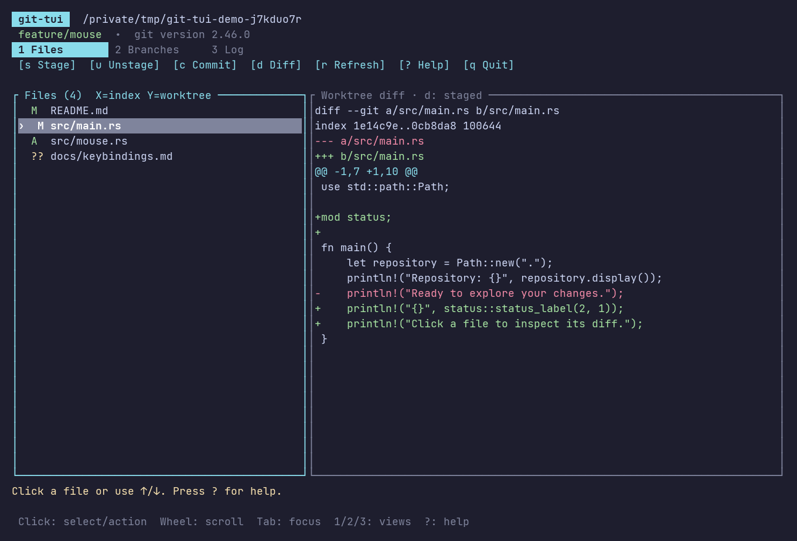
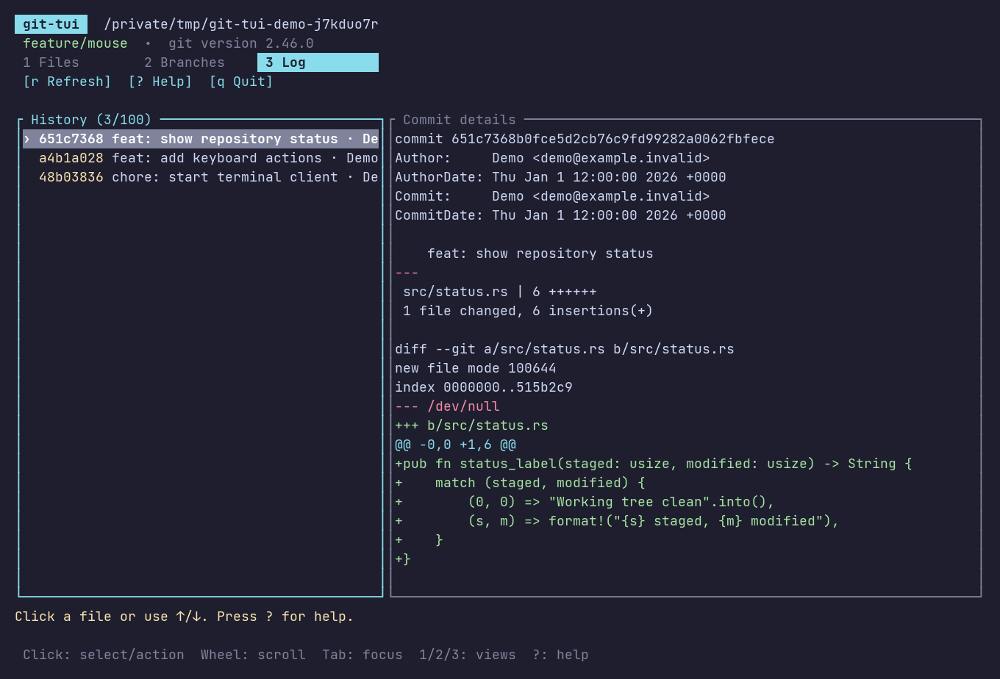

# git-tui

[](https://github.com/class-undefined/git-tui/actions/workflows/ci.yml)
[](https://github.com/class-undefined/git-tui/actions/workflows/release.yml)

使用 Rust 编写、支持鼠标操作的本地 Git 终端客户端。最低 Git 版本为 **1.8.3.1**，覆盖 CentOS 7 官方 yum 仓库的版本。

项目专注本地 Git 工作流，不规划 Gitea 集成。

## 运行截图

文件状态与工作区差异，可点击文件、按钮和标签，使用滚轮浏览差异：



<details>
<summary>查看提交历史与提交详情截图</summary>



</details>

截图来自程序在 120 × 34 PTY 中操作演示仓库的真实输出，使用固定终端配色渲染；[生成方式](docs/images/README.md)可复现。

## 功能

- 工作区状态：区分暂存区、工作区、未跟踪文件与合并冲突。
- 差异：切换工作区/暂存区差异，预览未跟踪文本，查看提交详情；支持纵向、横向滚动。
- 文件级暂存、取消暂存；取消暂存保留工作区内容，包括首次提交之前的文件。
- 输入提交摘要并提交暂存内容；支持中文、粘贴和 Git hooks，失败时保留输入。
- 本地分支列表、创建分支、确认后切换分支；使用 Git 的正常保护机制保留未提交修改。
- 最近 100 条当前分支提交记录；支持 detached HEAD 和空仓库。
- 鼠标点击标签、文件、按钮和弹窗；滚轮操作所在面板。
- 后台串行执行 Git、每 3 秒刷新、预览过期结果丢弃、退出/异常/信号时恢复终端。

当前只提供文件级暂存和单行提交摘要；不包含 hunk/行级暂存、网络同步、rebase、stash、丢弃工作区改动等操作。

## 安装与运行

### 支持平台

| 系统 | 架构 | 安装包目标 |
| --- | --- | --- |
| macOS 11+ | Apple Silicon / ARM64 | `aarch64-apple-darwin` |
| Linux，包括 CentOS 7 | x86_64 | `x86_64-unknown-linux-musl` |
| Linux | ARM64 / aarch64 | `aarch64-unknown-linux-musl` |

Linux 安装包为静态 musl 二进制，不依赖目标机的 glibc 版本。所有平台运行时均需要 Git ≥ 1.8.3.1；预编译安装包不需要 Rust。验证环境与边界见 [兼容性说明](docs/compatibility.md)。

### 预编译安装包

版本标签发布后，[GitHub Releases](https://github.com/class-undefined/git-tui/releases) 会自动提供三个平台的 tar.gz、`SHA256SUMS` 和更新说明。可直接下载适合本机的安装包；下面用 `gh` 下载全部附件并校验，以 macOS ARM64 解压为例：

```sh
# 将 v0.1.0 替换为实际发布的版本
gh release download v0.1.0 --repo class-undefined/git-tui \
  --pattern '*.tar.gz' --pattern SHA256SUMS
shasum -a 256 -c SHA256SUMS          # Linux 也可用 sha256sum -c SHA256SUMS
tar -xzf git-tui-v0.1.0-aarch64-apple-darwin.tar.gz
mkdir -p "$HOME/.local/bin"
install -m 755 git-tui "$HOME/.local/bin/git-tui"
"$HOME/.local/bin/git-tui" /path/to/repository
```

Linux 请按上表选择对应架构的压缩包。将 `~/.local/bin` 加入 `PATH` 后，可以直接执行 `git-tui`。

尚未打版本标签时，可从成功的 [CI](https://github.com/class-undefined/git-tui/actions/workflows/ci.yml) 下载 `package-<target>` artifact，例如：

```sh
gh run download <run-id> --repo class-undefined/git-tui \
  --name package-aarch64-apple-darwin --dir git-tui-package
cd git-tui-package
shasum -a 256 -c *.sha256
tar -xzf git-tui-v0.1.0-aarch64-apple-darwin.tar.gz
./git-tui --check /path/to/repository
```

### 从源码安装

开发工具链固定为 Rust 1.94.1；Git 运行时版本与 Rust 构建工具链是两个独立要求。

```sh
cargo install --git https://github.com/class-undefined/git-tui --locked
git-tui /path/to/repository

# 或从源码运行
git clone https://github.com/class-undefined/git-tui
cd git-tui
cargo run --release -- /path/to/repository
```

鼠标默认开启，需要终端支持鼠标事件（通过 SSH 使用时同样适用）。最小尺寸为 60 列 × 16 行；宽度不足 90 列时使用上下布局。

```sh
git-tui --no-mouse                 # 关闭鼠标捕获，便于终端文本选择
git-tui --git /path/to/git         # 指定 Git；也支持 GIT_TUI_GIT 环境变量
git-tui --check /path/to/repo       # 非交互诊断，不进入 TUI
git-tui --help
```

提交使用仓库已有的 `user.name` / `user.email` 与 hooks。子进程不能读取交互式输入；需要交互式签名/编辑器的 hooks 应在独立终端运行。每个 Git 子进程的时限为 30 秒；超时后先检查仓库状态再重试。

### CentOS 7

下载 `x86_64-unknown-linux-musl` 安装包并复制到 CentOS 7，继续使用 yum 提供的 Git 即可，不要求在目标机安装现代 Rust 或升级系统 Git。CI 会把同一个发布二进制放入 CentOS 7 容器，配合官方 yum Git 1.8.3.1 运行集成测试。

## 操作

| 按键 | 操作 |
| --- | --- |
| `1` / `2` / `3` | 文件 / 分支 / 日志 |
| `↑` / `↓` 或 `k` / `j` | 选择项目，或滚动已聚焦的差异面板 |
| `Tab`，`h` / `l` | 切换面板焦点 |
| `H` / `L` | 横向滚动差异 |
| `PageUp` / `PageDown`，`Home` / `End` | 翻页，到开头/结尾 |
| `s` / 空格 | 暂存选中文件 |
| `u` | 取消暂存选中文件 |
| `d` | 切换工作区/暂存区差异 |
| `c` | 提交暂存内容 |
| `n` | 创建并切换分支 |
| `Enter` | 分支视图中请求切换；其他视图聚焦差异 |
| `r` | 刷新 |
| `?` | 帮助 |
| `Esc` | 关闭弹窗；无弹窗时退出 |
| `q` / `Ctrl-C` | 退出；正在执行修改操作时等待完成后重试 |

所有主要操作也可点击界面按钮。弹窗内 `Enter` 提交，`Esc` 取消，`Backspace` 删除末尾字符。鼠标滚轮操作指针所在面板；水平滚轮可横向滚动差异。

## 开发与验证

```sh
cargo fmt --check
cargo clippy --all-targets --locked -- -D warnings
cargo test --locked
cargo build --locked

# 下载并校验官方源码，编译真实 Git 1.8.3.1（不替换系统 Git）
sh scripts/build-legacy-git.sh
GIT_TUI_TEST_GIT="$PWD/.tools/git-1.8.3.1/bin/git" \
  cargo test --locked --test git_workflows

# 真实 PTY 鼠标操作、中文粘贴、提交、分支与终端恢复
uv run --with pyte==0.8.2 python scripts/pty-smoke.py target/debug/git-tui
cargo run -- --help
```

架构与设计约束见 [架构说明](docs/architecture.md)，贡献约定见 [CONTRIBUTING.md](CONTRIBUTING.md)。

CI 在 macOS ARM64、Linux x86_64 和 Linux ARM64 原生 runner 上构建、运行测试，并使用最终 release 二进制执行 PTY 鼠标测试；另覆盖上游 Git 1.8.3.1 和 CentOS 7 官方 yum Git。

推送与 `Cargo.toml` 版本一致的 `v*` 标签会自动发布；手动运行 Release workflow 可完整演练而不发布。流程、版本规则和失败恢复见 [发布说明](docs/releasing.md)。

## 参考

交互参考 [gitu](https://github.com/altsem/gitu) 的本地 Git 工作流；需求调研参考 [gitea-idea-plugin](https://github.com/LeonDevLifeLog/gitea-idea-plugin)。本项目独立实现，不复制参考项目代码，也不包含 Gitea 功能。

Git 基线来源：[CentOS 7 官方归档](https://vault.centos.org/centos/7/updates/x86_64/Packages/)。

## License

MIT
