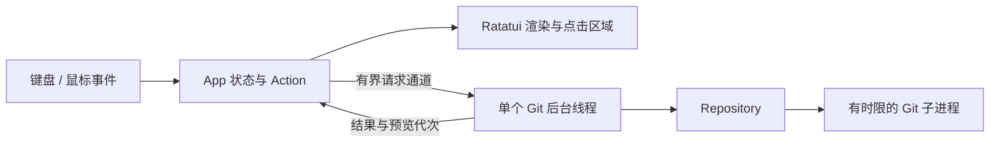

# 架构

首版只处理本地 Git 状态、差异、暂存、提交、分支与日志，不引入 Gitea 或其他托管平台 API。

| 模块 | 职责 |
| --- | --- |
| `src/main.rs` | CLI、事件循环、定时刷新、退出信号 |
| `src/app/` | 应用状态、键鼠到 Action 的映射、操作排队、弹窗、选择与滚动状态 |
| `src/ui.rs` | 布局、渲染、从实际区域生成鼠标命中位置 |
| `src/i18n.rs` | 中英文文本目录、结构化状态和预览的本地化 |
| `src/settings.rs` | 语言优先级、配置读取与原子保存 |
| `src/terminal.rs` | raw mode、alternate screen、鼠标、粘贴与恢复 guard |
| `src/worker.rs` | 单线程 Git 调度、有界通道、结果返回 |
| `src/git/` | 字节路径、porcelain 解析、兼容命令、子进程资源限制 |

## 语言与设置

所有静态翻译通过类型化 key 集中定义，每个 key 必须同时提供中英文；新增语言时由穷尽匹配约束覆盖。Git 层返回 `HeadState`、`PreviewKind` 和原始内容，成功操作通过 `Mutation` 描述；前端负责生成文字，不对 Git 输出或用户内容做字符串替换。错误的应用层说明本地化，Git/系统诊断详情保留原文。

状态消息存储类型化内容，预览保留原始结构并缓存显示文本，仅在数据或语言变化时重新格式化。语言切换不改变预览请求的代次、当前选择和滚动位置；尚在后台运行的结果返回后，使用当时的界面语言显示。原始预览与显示缓存均受现有输出上限约束。

启动时按 `--lang`、配置文件、POSIX locale 的优先级选择语言。配置文件位于 `$XDG_CONFIG_HOME/git-tui/language` 或 `$HOME/.config/git-tui/language`，仅含 `en` / `zh`。只接受绝对配置目录，读取上限为 64 字节，损坏配置不会阻止启动。

语言弹窗确认后立即更新界面；保存通过已有的有界 worker 通道执行，避免文件系统写入阻塞 UI。临时文件与目标文件在同一目录，写入和 flush 成功后执行原子重命名。失败时保留已有配置、提示本次会话尚未保存；设置保存期间会阻止普通退出，完成后可再次按 q 退出。自动化测试使用隔离配置目录，不读写开发者的偏好。

## 并发与状态

UI 线程只处理输入和渲染，不执行 Git。请求与响应通道容量均为 1，最多一个请求在执行；修改操作串行化。导航可以继续进行，新的预览请求合并为当前选择。每次选择或刷新使预览代次递增，结果只有在代次和目标都匹配时才会显示。

刷新按文件路径、分支名、提交 ID 保留选择。若预览目标未改变，刷新保留内容与滚动位置，同时重新读取差异，以覆盖“XY 状态不变、内容再次改变”的情况。界面只在状态变化时重绘，不进行持续空闲渲染。

操作失败后仍尝试刷新仓库，因为 hook、超时或部分失败可能改变暂存区。提交或分支输入失败时保留文本。修改操作执行期间禁止重复提交和普通退出；收到进程退出信号后恢复终端，并等待后台操作结束。

## 终端与路径

使用 Ratatui 的 Crossterm re-export，保证只有一个 Crossterm 版本。终端初始化之前创建恢复 guard；部分初始化失败、正常退出、错误与 panic 都恢复终端。额外处理鼠标、粘贴、焦点事件和光标；SIGTERM/SIGHUP/SIGINT 转为退出标记，事件循环负责清理。无法捕获的 SIGKILL 不在恢复保证范围内。

命中区域直接来自当次渲染，列表点击加上 `ListState::offset()`；resize 立即清空旧区域。弹窗阻止背景点击与快捷键。宽字符输入按终端显示宽度截取尾部，保持光标在弹窗内。

Unix 文件路径以 `OsString` / `PathBuf` 保留原始字节；只有显示时转换文本、转义控制字符。命令使用独立参数、`--`、全局 literal pathspec 和 `./` 路径前缀，处理空格、换行、`*`、`-` 与 `:(...)`。错误输出和仓库文本不能通过 ESC 控制序列影响终端。

## 子进程边界

每个命令在独立进程组中运行，stdin 关闭，stdout/stderr 分别排空，避免 pipe 填满造成死锁。捕获最多各 2 MiB；预览提示截断，结构化结果过大时明确报错。未跟踪文本预览最多 256 KiB；符号链接只展示链接目标，二进制不作为文本展示。

每个 Git 子进程最长 30 秒。结束或超时后清理进程组与 hook 后代并回收进程。退出时关闭通道并 join 工作线程，不遗留后台写操作。时限是单条命令的时限，不是整个刷新事务的总时限。

## 验证

- 后端集成测试使用临时仓库和真实 Git，不 mock Git 命令的行为。
- Ratatui `TestBackend` 验证滚动后的鼠标定位、弹窗隔离、等价键鼠操作、过期预览、保留滚动及小窗口布局。
- PTY 测试使用真正的 Crossterm 事件、SGR 鼠标协议、粘贴与中文提交，并检查退出控制序列和 termios 恢复。
- 中英文 PTY 测试覆盖真实鼠标操作、F2 键盘切换、重启持久化、CLI/locale 优先级、损坏配置与写入失败；测试终端修正 pyte 0.8.2 覆盖宽字符后遗留续格的行为，按终端列定位鼠标。
- CentOS 7 容器运行与现代主机相同的 musl 集成测试程序，调用容器内 yum 安装的 `/usr/bin/git`。
